
Engenheiro de software full stack com mais de 10 anos de experiência, a maior parte deles em Ruby on Rails. Construo produtos completos com agentes de IA, do back-end aos apps web, desktop e mobile.

> **In English:** Full stack software engineer with 10+ years of experience, most of them in Ruby on Rails. I build complete products with AI agents, from the back end to web, desktop and mobile apps. My main project is GOAT, a Brazilian CRM with WhatsApp, AI agents and payments.

<a href="https://goat.polemk.com/"></a>

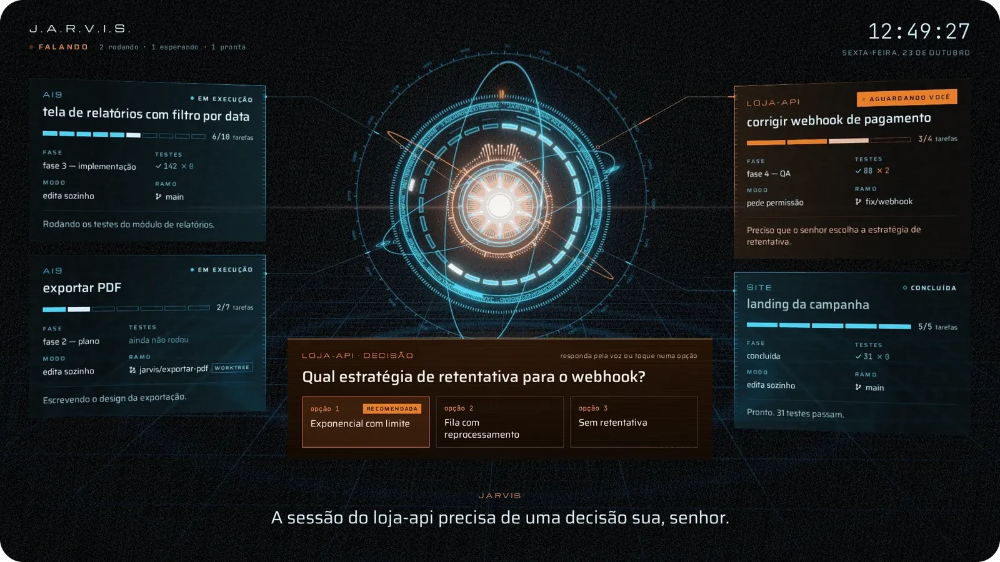

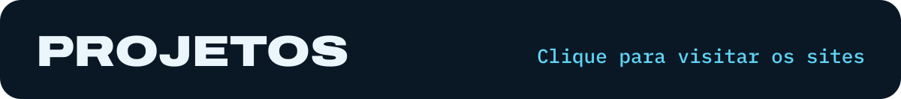

<a href="https://metalmonarca.com.br/">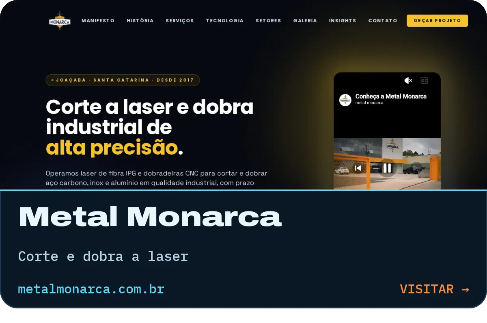</a>      <a href="https://www.objetivolages.com.br/">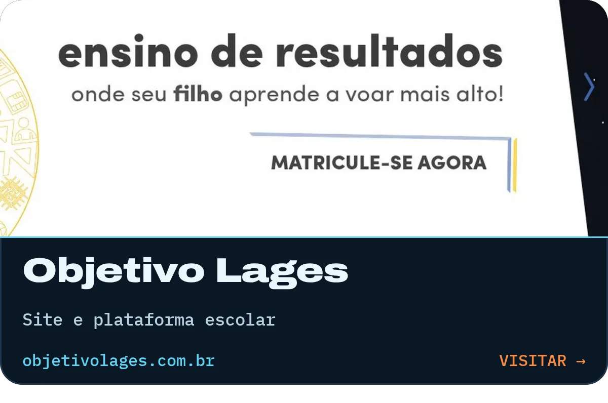</a> <a href="https://www.acaipuronativo.com.br/">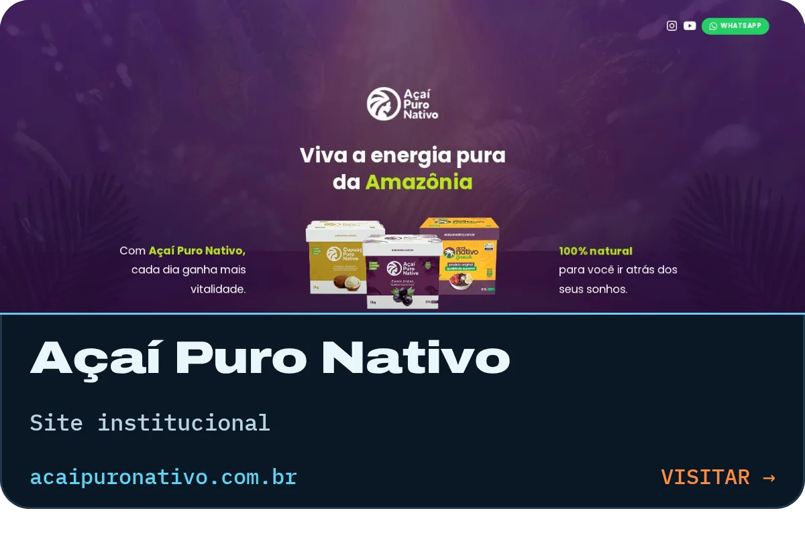</a> <a href="https://protocolotruppel.polemk.com/">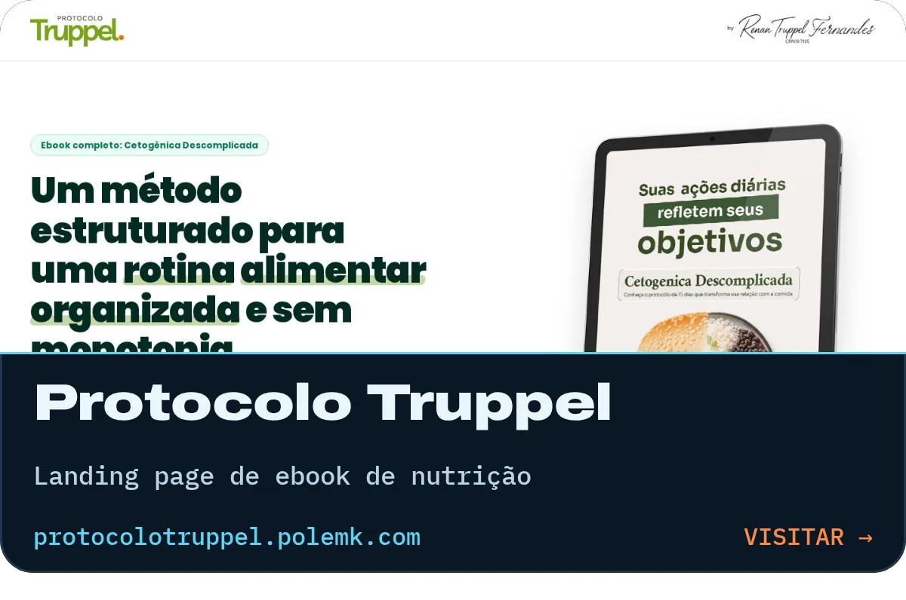</a> <a href="https://pika.polemk.com/">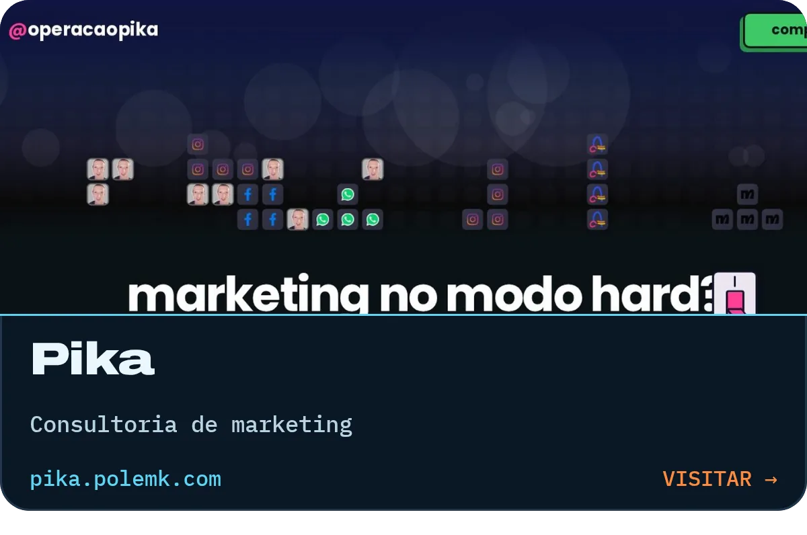</a> <a href="https://brsw.org/">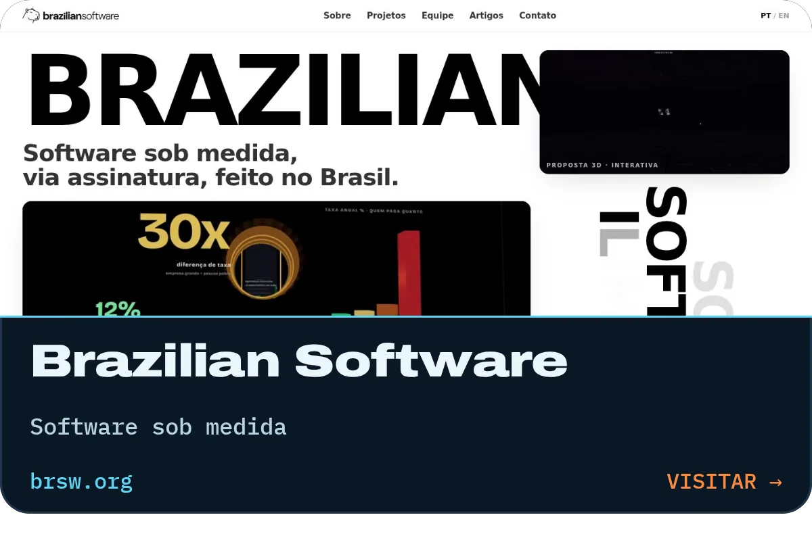</a> <a href="https://polemk.com/">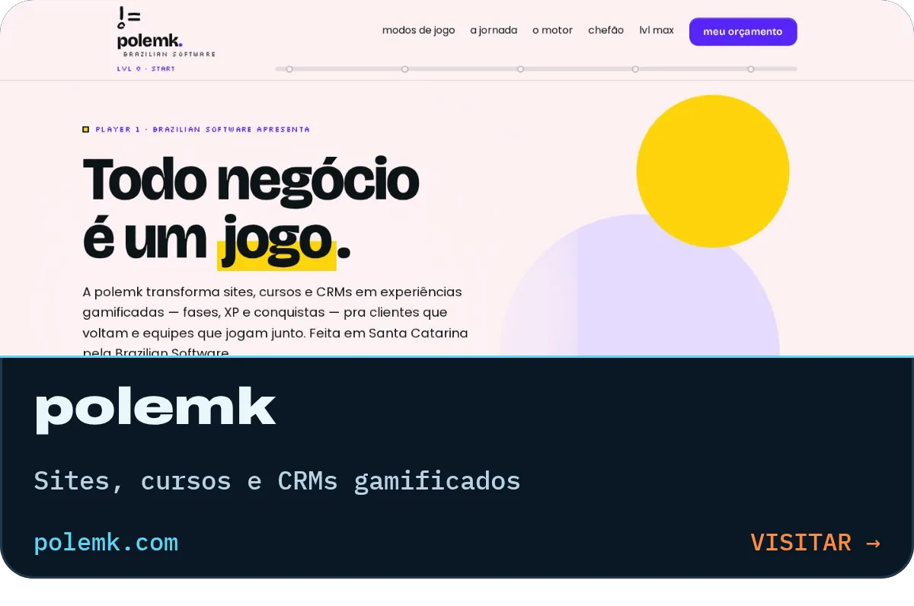</a>

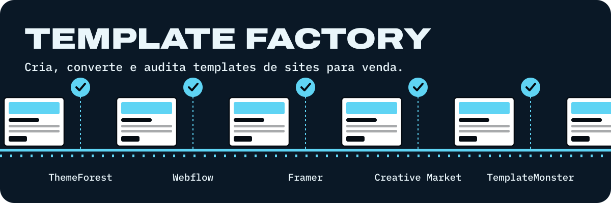

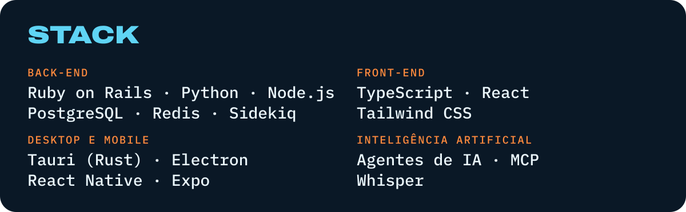

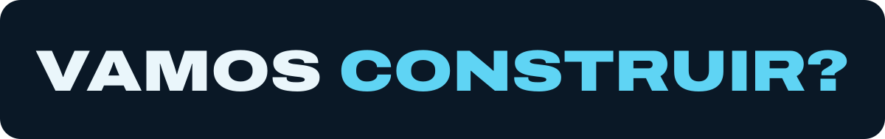

<a href="https://www.linkedin.com/in/vsnnascimento">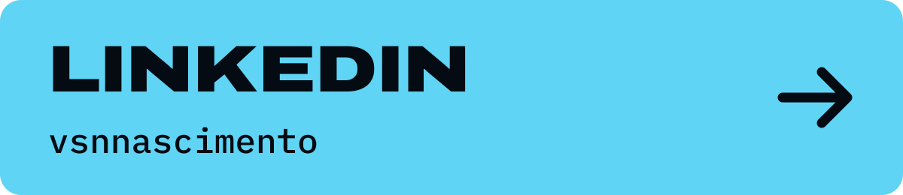</a> 

O código dos projetos é privado.
